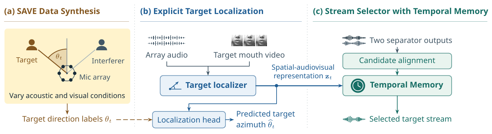
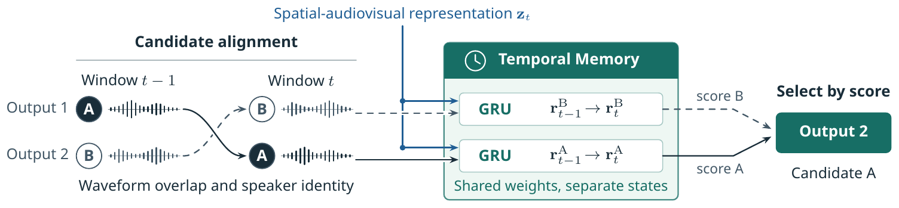

# ELMA: **E**xplicit **L**ocalization and **M**emory for **A**udiovisual speech separation

Implementation accompanying *When Short Visual Context Is Ambiguous: Explicit Localization and Temporal Memory for Low-Latency Speech Separation*.

A short window may contain too little lip motion to tell which separated voice belongs to the person on camera. The separator may also return that speaker on a different output in the next window. ELMA uses the microphone array and the target mouth video to follow the visible speaker across windows. With a 1 s window, it returns 0.4 s of speech per step.



## How ELMA selects the target

1. **SAVE data synthesis.** SAVE simulates Mandarin mixtures for a specified microphone array under varied acoustic and visual conditions. Each target has a direction label for training the localizer and a clean waveform for learning which separated stream to select.
2. **Explicit target localization.** During training, the localizer predicts the visible speaker’s direction from multichannel audio and mouth video. At inference, the stream selector uses the learned spatial-audiovisual representation directly. Both candidates share this representation.
3. **Stream selection with temporal memory.** ELMA aligns the two separator outputs across adjacent windows and maintains a separate recurrent state for each candidate. Each update combines the shared representation with the candidate’s speaker embedding and its audiovisual match score. The selector returns the candidate with the higher corrected score for the current output interval.



*Figure 4. Both candidates share the spatial-audiovisual representation and GRU weights. Each keeps its own memory state when the separator changes output order.*

## Listen to the two speakers

To play both clips on one page, download the [standalone demo player](docs/demos/player.html) and open it in a browser. Both clips are included in the file.

These clips use the same 12-second campus recording. Listen to the mixture first, then compare the two target voices in the second clip.

- [Original mixture (MP4, 12 s)](docs/demos/mixture.mp4) — both speakers are audible together.
- [Selected speech with 1 s windows (MP4, 24 s)](docs/demos/selected-speech-1s.mp4) — the same segment plays twice, targeting the speaker in the white shirt first and the other speaker at 0:12. This recording demonstrates the earlier SAV-BandNet prototype.

## Results reported in the paper

Character error rate (CER) on the SAVE test set with **1 s windows**. Lower is better.

| System | CER |
| --- | ---: |
| ELMA | **22.54%** |
| AV-MossFormer2, fine-tuned | 36.50% |
| DAVE + TalkNet, fine-tuned | 41.50% |

ELMA and fine-tuned DAVE + TalkNet select between identical candidate waveforms. With this window configuration, ELMA has 0.6 s inherent latency and takes 152 ms per window on an NVIDIA H20.

## Running the code

Follow the [environment and asset setup](docs/setup.md) to install the dependencies, prepare a compatible model bundle in `assets/default`, and set `SAVE` and `OUTPUT` to local directories. This repository contains the training and inference code. The model weights and SAVE recordings must be provided locally to run these commands.

**Validate the bundle and dataset manifests** before starting a GPU run:

```bash
python -m hisav train --data "$SAVE" --bundle assets/default --output "$OUTPUT/training" --check
```

**Run inference** on the 2,000 SAVE test scenes using the supplied bundle:

```bash
python -m hisav infer --data "$SAVE" --bundle assets/default --output "$OUTPUT/evaluation"
```

**Fine-tune** on the 32,768 SAVE training scenes:

```bash
python -m hisav train --data "$SAVE" --bundle assets/default --output "$OUTPUT/training"
```

The [training recipe](docs/recipe.md) describes the stages, supervision, and checkpoint provenance. See the [third-party notices](THIRD_PARTY_NOTICES.md) for the vendored components.
